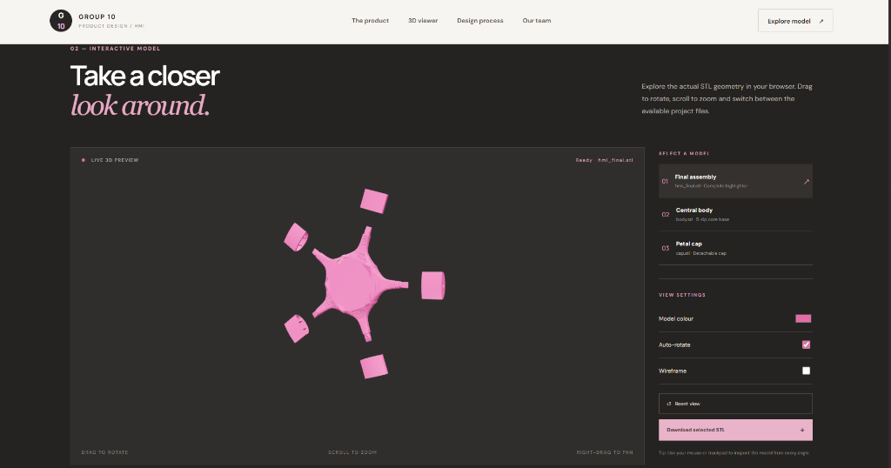
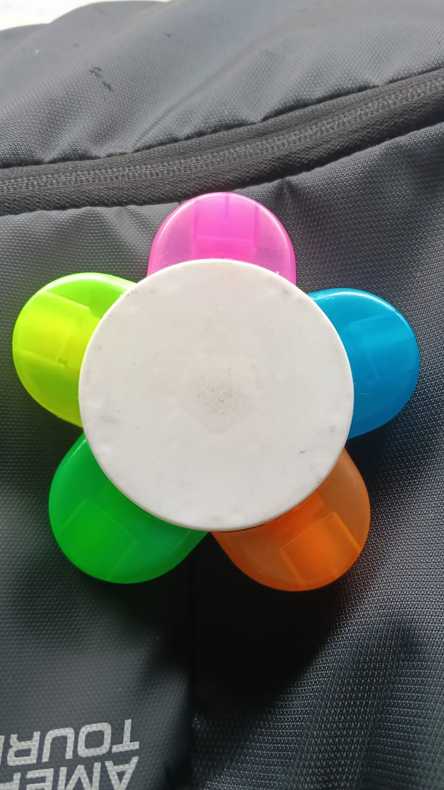
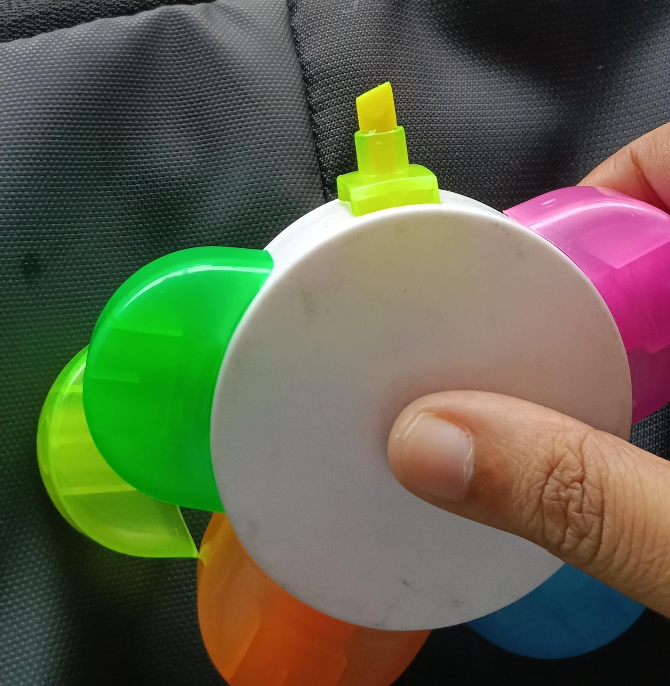
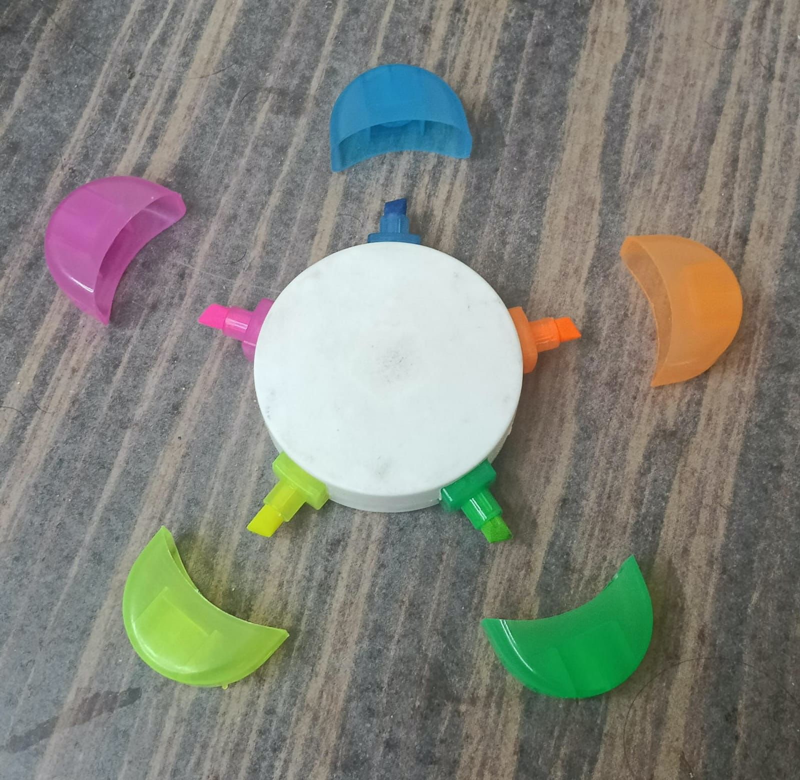
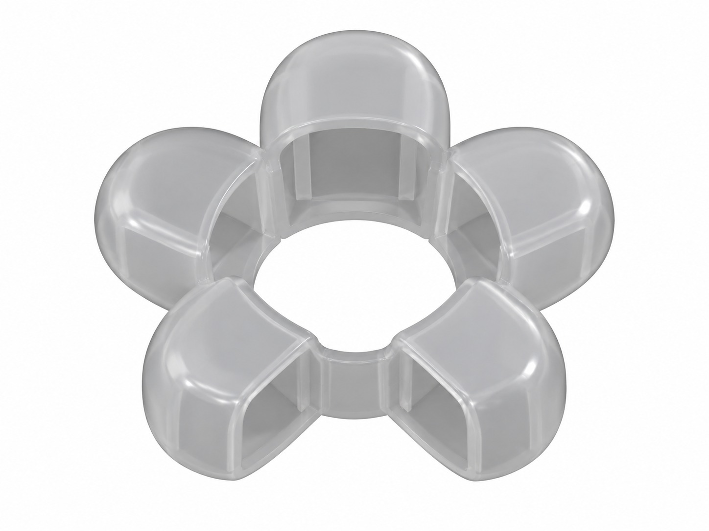
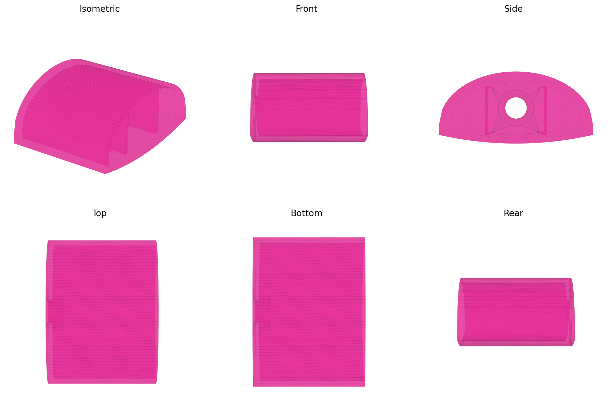

# 🌸 Petal — 5-in-1 Multi-Coloured Highlighter
### Human Machine Interaction (HMI) Theory ISE · Group 10

[](https://aarnaaa22.github.io/3D_Model_HMI/)
[](https://threejs.org/)
[](#team-members)

> **Live Website:** [https://aarnaaa22.github.io/3D_Model_HMI/](https://aarnaaa22.github.io/3D_Model_HMI/)  
> **Author & Team Leader:** Made by Aarna Chopdekar

---

## 📸 Project Showcase & Screenshots

### 1. Interactive 3D Web Viewer (Live in Browser)
Explore the STL geometry in real time with OrbitControls, custom material shading, auto-rotation, and wireframe modes:


### 2. Physical Product Prototype
The fully assembled flower-shaped multi-coloured highlighter featuring 5 distinct highlighter caps and tips:


### 3. Ergonomics & Scale (In-Hand Evaluation)
Compact, rounded floral form contoured to fit comfortably into the palm during long study and reading sessions:


### 4. Modular Detachable Components
The 5 petal caps unclipped from the central ink reservoir base, demonstrating the quick-switch design:


### 5. CAD Assembly & Technical Drawings
Engineered in CAD with snap-fit retention tolerances to keep highlighter nibs airtight:
| CAD 3D Model | Orthographic Projections |
| :---: | :---: |
|  |  |

---

## 💡 About The Product

**Petal** is an ergonomic, flower-inspired 5-in-1 multi-coloured highlighter designed around human-centred interaction principles.

Instead of carrying five bulky highlighter pens that clutter pencil cases and slow down note-taking, **Petal** integrates five vibrant highlighter cartridges (pink, yellow, green, blue, and orange) into a single radial central core.

### Key Features
- **5 Vibrant Colours in One Tool:** Quickly switch between highlighting shades without juggling multiple pens.
- **Palm-Friendly Ergonomic Grip:** Natural floral contours provide comfortable rests for fingers during highlighting and reading.
- **Airtight Snap-Fit Caps:** Precision tolerances ensure caps snap securely to prevent ink nibs from drying out.
- **Tactile & Visual Feedback:** Color-coded petal modules provide immediate visual clarity on which shade is being uncapped.

---

## 🖥️ Interactive 3D Viewer Capabilities

The web showcase includes an interactive 3D canvas built with **Three.js** and **STLLoader**:
- **Full Model Assembly (`hmi_final.stl`):** Complete flower highlighter with core and 5 petal caps.
- **Central Core (`body.stl`):** The star-configured 5-reservoir central body.
- **Petal Cap (`cap.stl`):** Individual detachable snap cap.
- **Real-Time Controls:**
  - 🔄 **360° Drag-to-Rotate, Scroll-to-Zoom, and Right-Drag-to-Pan**
  - 🎨 **Live Color Picker:** Customise the model shade in real time
  - ⚡ **Auto-Rotation & Wireframe Toggle**
  - 💾 **Instant STL Download:** Direct access to download CAD files for 3D printing
  - 📂 **Local File Fallback:** Drag & drop any `.stl` file directly onto the viewer

---

## 🚀 Running Locally

To run the interactive 3D showcase on your computer:

### Option 1 — VS Code Live Server (Recommended)
1. Open this project folder in **VS Code**.
2. Right-click `index.html` and click **"Open with Live Server"**.
3. The site will open automatically at `http://127.0.0.1:5500`.

### Option 2 — Python HTTP Server
```bash
python -m http.server 8000
```
Then visit `http://localhost:8000` in your web browser.

### Option 3 — Node.js
```bash
npx serve .
```

---

## 👥 Team & Credits

**Group 10 · Human Machine Interaction (HMI Theory ISE)**

- **Team Leader:** **Aarna Chopdekar** (10712) — *Made by Aarna Chopdekar*
- **Team Member:** Slora Bar (10708)
- **Team Member:** Larissa D’abreo (10718)
- **Team Member:** Ruth D’mello (10721)
- **Team Member:** Kinjal Goyal (10732)

